# Awesome-Statistical-Analysis-Data-Science 📊

<div align="center">



<br/>

[](https://awesome.re)
[](https://creativecommons.org/publicdomain/zero/1.0/)
[](https://github.com/ishandutta2007/Awesome-Statistical-Analysis-Data-Science/pulls)
[](https://github.com/ishandutta2007/Awesome-Statistical-Analysis-Data-Science/graphs/commit-activity)

**A curated collection of leading Statistical Analysis and Data Science platforms — comparing commercial SaaS/Enterprise suites with high-performance open-source tools for statistical computing, predictive modeling, Bayesian inference, and machine learning pipelines.**

🌟 *Star this repository if you find it helpful!* 🌟

</div>

---

## 📑 Table of Contents

- [🌐 Sector Overview & Market Dynamics](#-sector-overview--market-dynamics)
- [🏢 SaaS & Hosted Commercial Platforms](#-saas--hosted-commercial-platforms)
- [💻 Open-Source Software & Toolkits](#-open-source-software--toolkits)
- [⚖️ Feature Matrix & Architecture Comparison](#-feature-matrix--architecture-comparison)
- [🤝 Contributing & Community Guidelines](#-contributing--community-guidelines)
- [📄 License](#-license)

---

## 🌐 Sector Overview & Market Dynamics

The global **statistical analysis software market** is valued at approximately **$10 billion to $11 billion**, expanding toward **$18 billion** at a 7–9% CAGR, while the broader **data science & MLOps platform market** is currently valued at **$95 billion to $180 billion** and compounding at an explosive 26–33% CAGR toward **$400B+ to $1T+** over the next decade.

The sector exhibits an **oligopolistic, concentrated enterprise tier coupled with a highly fragmented cloud and open-source landscape**: mission-critical regulated sectors (life sciences, clinical trials, national statistics, banking) remain tightly concentrated among legacy incumbents like SAS and IBM SPSS due to compliance and validation standards, while modern enterprise workflows are heavily fragmented across cloud hyperscalers (AWS, Azure, GCP) and an agile long-tail of open-source frameworks (Python, R, Julia, Rust) driving everyday data science innovation.

---

## 🏢 SaaS & Hosted Commercial Platforms

Below is a detailed benchmark of commercial, cloud-hosted, and managed statistical analysis and data science platforms, ordered by company scale (**Market Cap / Enterprise Valuation / Annual Revenue, descending**).

| Platform | Category / Focus | Company Scale (Valuation / Revenue) 🏢 | Starting Tier Pricing 💰 | Free Tier & Trial Limits ⏳ | Deployment Models ☁️ |
|:---|:---|:---|:---|:---|:---|
| **[IBM SPSS Statistics](https://www.ibm.com/products/spss-statistics)** | Social science & advanced predictive statistics | **~$277B Market Cap** *(IBM parent ~\$62B ann. rev)* | **$109 / user / month** *(Base Edition, billed monthly or annually)* | **14-day free trial** *(Full access to Base Edition + all major add-on features, no credit card required)* | Cloud SaaS, Windows, macOS Desktop |
| **[Alteryx Designer Cloud](https://www.alteryx.com/)** | Visual data preparation, automated ETL & analytics | **$4.4B Valuation** *(Acquired by Clearlake & Insight; ~$970M rev)* | **$250 / user / month** *(Starter Edition, $3,000 billed annually per user)* | **30-day free trial** *(Full platform evaluation access to Designer Cloud & Desktop)* | Cloud Hosted, Windows Desktop |
| **[Dataiku DSS](https://www.dataiku.com/)** | Collaborative enterprise data science & MLOps | **$3.7B Valuation** *(Series F; ~$340M ARR)* | **~$4,000 / month** *(~$50,000/year custom starting platform tier)* | **Free Edition (Self-Hosted):** Free forever for 1–3 local users, community support.<br>**Cloud Trial:** **14-day free trial** *(up to 5 users, capped at ~4 CPUs / 32 GB compute)* | Fully Managed SaaS, AWS/Azure/GCP, On-Premise |
| **[SAS Institute (Viya / On Azure)](https://www.sas.com/)** | Enterprise statistical computing & predictive analytics | **~$3.2B Annual Revenue** *(Privately held global market leader)* | **$6,000 / user / year** *(SAS Viya Workbench starting base license on Azure Marketplace)* | **14-day free trial** *(Full SAS Viya platform trial software license; underlying cloud VM compute billed separately)* | Managed Cloud, Azure/AWS Marketplace, On-Premise |
| **[MathWorks MATLAB Online](https://www.mathworks.com/products/matlab-online.html)** | Numerical computation, matrix algebra & statistical modeling | **~$1.5B Annual Revenue** *(Privately held, profitable since 1984)* | **$860 - $1,015 / year** *(Standard commercial annual license; Home edition $150/yr, Student $49/yr)* | **Free Tier:** **20 hours/month** *(Basic edition, 10 core toolboxes, 5 GB MATLAB Drive, 15 min session timeout).*<br>**Free Trial:** **30-day free trial** *(desktop + unlimited online suite)* | Browser SaaS (Cloud), Linux, macOS, Windows |
| **[Posit (RStudio) Cloud](https://posit.cloud/)** | Hosted R, Python, Quarto & Shiny data science workspace | **$164M+ Total Funding** *(Privately held; PBC)* | **$25 / month** *(Cloud Basic, 150 compute hours/mo, 8 GB RAM, 2 CPUs; Student from $5/mo)* | **Free Plan (Forever):** **25 compute hours/month**, 1 GB RAM, 1 CPU, 1-hour max execution, up to 25 projects, 3 concurrent projects | Fully Managed Cloud (Posit Cloud), Server, On-Premise |
| **[KNIME Commercial Hub](https://www.knime.com/)** | Visual workflow orchestration, MLOps & governance | **~€30M Annual Revenue** *(Raised $54M venture funding)* | **€19 / month ($19/mo)** *(Pro Tier; Team Tier at €99/mo for 3 users + €49/user/mo extra)* | **Free Plan (Forever):** Free KNIME Community Hub personal tier (public/private spaces, 20 K-AI prompts/mo).<br>**Trial:** **14-day free trial** for Team cloud automation features | Managed Cloud Hub, Private Cloud, Kubernetes |

---

## 💻 Open-Source Software & Toolkits

Self-hosted, community-driven statistical computing libraries, interactive GUI statistical packages, and scalable data processing engines. Ranked in **descending order by GitHub stargazers count**.

| Project & Repository 📦 | GitHub Stars ⭐ | Stack / Tech ⚙️ | License 📜 | Core Capabilities 🔍 | Primary Use Case 🎯 |
|:---|:---|:---|:---|:---|:---|
| **[scikit-learn](https://scikit-learn.org/)**<br>`scikit-learn/scikit-learn` | [](https://github.com/scikit-learn/scikit-learn/stargazers) | Python, Cython, C++ | BSD-3-Clause | Classical machine learning, classification, regression, clustering, model evaluation, and preprocessing pipelines | Industry standard for production machine learning & data mining in Python |
| **[pandas](https://pandas.pydata.org/)**<br>`pandas-dev/pandas` | [](https://github.com/pandas-dev/pandas/stargazers) | Python, Cython, C | BSD-3-Clause | Flexible DataFrames, time-series analysis, data alignment, aggregation, slicing, and statistical transforms | Essential tabular data wrangling and exploratory data analysis (EDA) |
| **[Apache Spark](https://spark.apache.org/)**<br>`apache/spark` | [](https://github.com/apache/spark/stargazers) | Scala, Java, Python, R | Apache-2.0 | Distributed cluster computing, Spark MLlib for scalable statistical learning, SQL queries, and streaming | Large-scale big data statistical computing and distributed data science |
| **[DuckDB](https://duckdb.org/)**<br>`duckdb/duckdb` | [](https://github.com/duckdb/duckdb/stargazers) | C++, C, Python, R | MIT | In-process analytical columnar SQL database engine, vectorized execution, direct zero-copy Parquet/Arrow analysis | Blazing-fast embedded statistical SQL analytics and local data lake queries |
| **[Polars](https://pola.rs/)**<br>`pola-rs/polars` | [](https://github.com/pola-rs/polars/stargazers) | Rust, Python | MIT | Lightning-fast multithreaded vectorized DataFrame library powered by Apache Arrow memory model | High-performance memory-efficient data frame transformations & feature engineering |
| **[Prophet](https://facebook.github.io/prophet/)**<br>`facebook/prophet` | [](https://github.com/facebook/prophet/stargazers) | Python, R, Stan, C++ | MIT | Automated decomposable additive time-series forecasting with trend shifts, seasonalities, and holiday effects | Business forecasting, capacity planning, and demand time-series modeling |
| **[Apache Arrow](https://arrow.apache.org/)**<br>`apache/arrow` | [](https://github.com/apache/arrow/stargazers) | C++, Rust, Python, Go | Apache-2.0 | Cross-language columnar in-memory data standard, zero-copy IPC, computational kernels for analytics | Foundation for zero-overhead interoperability across modern data science libraries |
| **[SciPy](https://scipy.org/)**<br>`scipy/scipy` | [](https://github.com/scipy/scipy/stargazers) | Python, Fortran, C++ | BSD-3-Clause | Scientific computing routines including probability distributions, hypothesis testing, numerical integration, and optimization | Fundamental scientific and mathematical computing in Python |
| **[statsmodels](https://www.statsmodels.org/)**<br>`statsmodels/statsmodels` | [](https://github.com/statsmodels/statsmodels/stargazers) | Python, Cython | BSD-3-Clause | Econometric modeling, OLS/GLM regressions, ARIMA/SARIMAX time series, ANOVA, hypothesis tests, and summary tables | Rigorous statistical hypothesis testing, econometrics, and statistical inference |
| **[PyMC](https://www.pymc.io/)**<br>`pymc-devs/pymc` | [](https://github.com/pymc-devs/pymc/stargazers) | Python, PyTensor | Apache-2.0 | Probabilistic programming language (PPL), Markov Chain Monte Carlo (MCMC, NUTS), and Variational Inference | Advanced Bayesian statistical modeling, causal inference, and parameter estimation |
| **[Orange Data Mining](https://orangedatamining.com/)**<br>`biolab/orange3` | [](https://github.com/biolab/orange3/stargazers) | Python, PyQt | GPL-3.0 | Visual programming canvas with modular widgets for data visualization, statistical exploration, and ML | Intuitive visual data exploration for educators, researchers, and beginners |
| **[RStudio Desktop / Posit](https://posit.co/download/rstudio-desktop/)**<br>`rstudio/rstudio` | [](https://github.com/rstudio/rstudio/stargazers) | C++, TypeScript, R | AGPL-3.0 | Comprehensive Integrated Development Environment for R and Python with plot viewers, debugger, and workspace explorer | Gold standard IDE for statisticians, academic researchers, and R developers |
| **[Linfa](https://github.com/rust-ml/linfa)**<br>`rust-ml/linfa` | [](https://github.com/rust-ml/linfa/stargazers) | Rust | MIT / Apache-2.0 | Comprehensive statistical learning and machine learning algorithms written in pure, memory-safe Rust | High-performance, zero-overhead statistical modeling embedded in Rust systems |
| **[Stan](https://mc-stan.org/)**<br>`stan-dev/stan` | [](https://github.com/stan-dev/stan/stargazers) | C++, R, Python | BSD-3-Clause | State-of-the-art platform for statistical modeling and high-performance Bayesian inference with No-U-Turn Sampler | Gold standard Bayesian data analysis across biostatistics, social sciences, and physics |
| **[R Source (Base R)](https://www.r-project.org/)**<br>`wch/r-source` | [](https://github.com/wch/r-source/stargazers) | C, Fortran, R | GPL-2.0 / GPL-3.0 | The canonical statistical computing engine and graphics environment with tens of thousands of CRAN packages | The foundational programming environment for academic, pharmaceutical, and scientific statistics |
| **[JASP](https://jasp-stats.org/)**<br>`jasp-stats/jasp-desktop` | [](https://github.com/jasp-stats/jasp-desktop/stargazers) | C++, R, QML | GPL-3.0 | Modern point-and-click statistical suite offering both frequentist and Bayesian hypothesis testing side-by-side | Accessible SPSS alternative tailored for psychology, education, and Bayesian research |
| **[jamovi](https://www.jamovi.org/)**<br>`jamovi/jamovi` | [](https://github.com/jamovi/jamovi/stargazers) | Python, R, HTML/JS | AGPL-3.0 | Intuitive spreadsheet-style GUI built on top of R with real-time dynamic APA formatted output updates | Open-source SPSS replacement for students, teachers, and experimental researchers |

---

## ⚖️ Feature Matrix & Architecture Comparison

| Platform / Tool | Type | Primary Interface | Statistical Modeling Depth | Visual Workflow / No-Code | Scalability (Out-of-Core / Distributed) | Self-Hostable |
|:---|:---|:---|:---:|:---:|:---:|:---:|
| **IBM SPSS** | Commercial Suite | Point-and-Click + Syntax | 🟢 Comprehensive | 🟡 Partial | 🟡 Moderate (Server edition) | ❌ (On-prem license) |
| **SAS Viya** | Enterprise Suite | Web Studio + Code (SAS/Python) | 🟢 Comprehensive | 🟢 Advanced | 🟢 Distributed Cloud Engine | ❌ (Enterprise deploy) |
| **Alteryx** | Analytics Platform | Visual Node Canvas | 🟡 Intermediate | 🟢 Native Workflow | 🟢 Enterprise Server / Cloud | ❌ |
| **Dataiku DSS** | Enterprise Data Platform | Visual Flow + Python/R Notebooks | 🟢 Advanced | 🟢 Native Flow | 🟢 Pushdown SQL / Spark / Cloud | 🟡 (Free local edition) |
| **MathWorks MATLAB** | Numerical Computing | Matrix Script + Interactive Apps | 🟢 Comprehensive | 🟡 App Designer | 🟢 Parallel Computing Toolbox | ❌ (Local desktop) |
| **Posit Cloud / RStudio** | IDE & Workspace | Code Editor (R / Python / Quarto) | 🟢 Comprehensive (CRAN) | 🔴 Code-Centric | 🟢 Slurm / Kubernetes cluster | ✅ (RStudio Server OSS) |
| **KNIME Analytics** | Visual Data Platform | Visual Node Canvas + Python/R | 🟢 Advanced | 🟢 Native Canvas | 🟢 Spark / Cloud Executors | ✅ (Full OSS Desktop) |
| **scikit-learn** | Python Library | Python API | 🟢 Advanced ML | 🔴 Code-Centric | 🟡 Joblib parallel, Dask-ML | ✅ (Open Source) |
| **DuckDB / Polars** | Columnar Engine | Python, Rust, SQL | 🟡 Analytical & Metrics | 🔴 Code-Centric | 🟢 Multi-threaded / Streaming | ✅ (Open Source) |
| **PyMC / Stan** | Bayesian PPL | Python / R / Stan DSL | 🟢 Bayesian Inference | 🔴 Code-Centric | 🟢 GPU & Multi-chain CPU MCMC | ✅ (Open Source) |
| **JASP / jamovi** | Statistical GUI App | Interactive Spreadsheet UI | 🟢 Frequentist & Bayesian | 🟢 Pure Point-and-Click | 🔴 Local Desktop memory | ✅ (Open Source Desktop) |

---

## 🤝 Contributing & Community Guidelines

Contributions, improvements, and new tool submissions are very welcome! To maintain high editorial quality:

1. **Relevance:** The project must be dedicated to statistical analysis, mathematical modeling, econometrics, or data science workflows.
2. **Quality & Maintenance:** Open-source projects should demonstrate active maintenance, documentation, and a clear open-source license.
3. **Format:** Submit your pull request adhering to the existing tabular schema with verified links, accurate pricing/stargazer data, and neutral descriptive summaries.

```bash
# Fork the repository, clone, and create a feature branch
git checkout -b feat/add-new-statistical-tool
git commit -m "feat: add NewTool to open-source matrix"
git push origin feat/add-new-statistical-tool
```

---

## 📄 License

This compilation is licensed under the creative commons [CC0 1.0 Universal](LICENSE) (Public Domain Dedication). All linked software, platforms, libraries, and trademarks belong to their respective creators and owners.

<div align="center">

Made with ❤️ by the open-source data science community. **Don't forget to ⭐ star the repository!**

</div>
